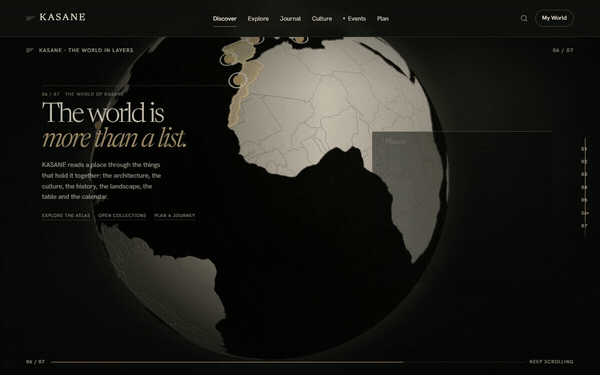
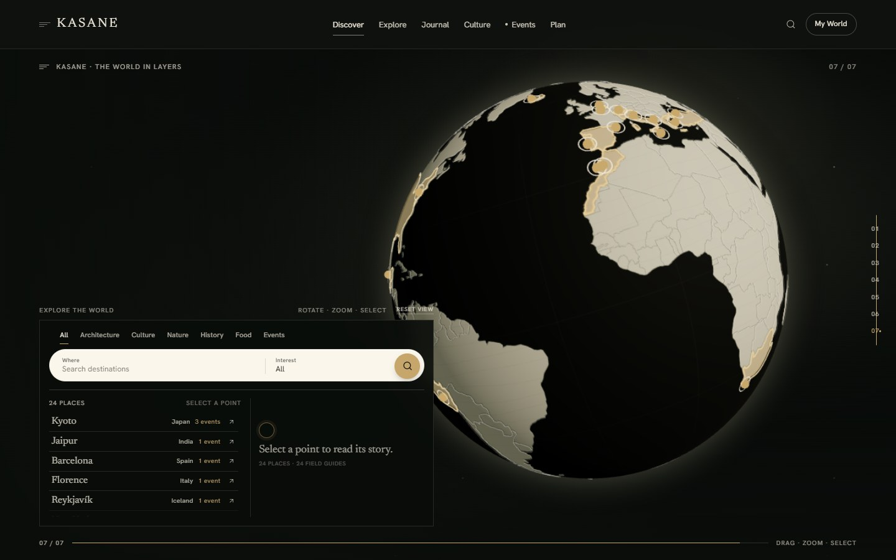
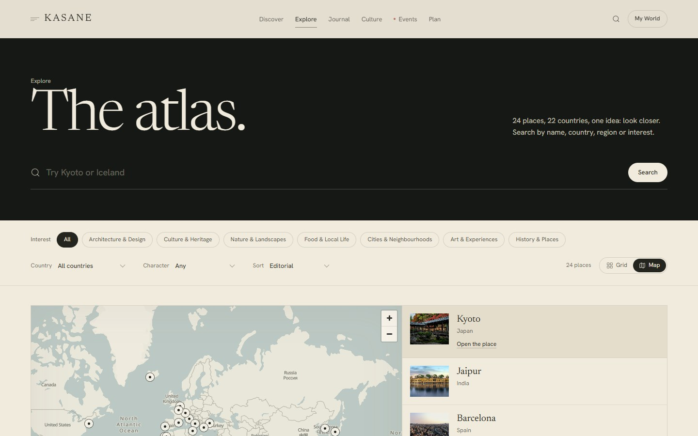
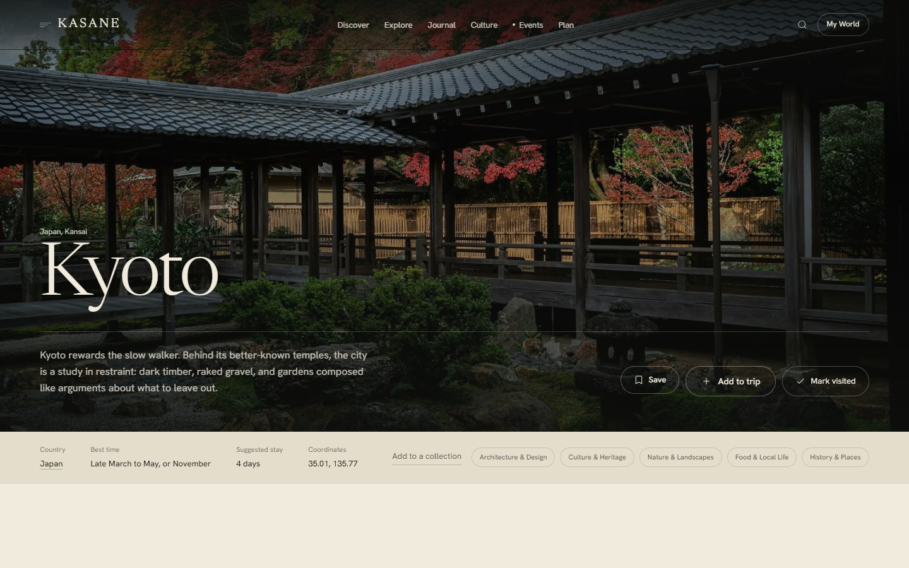
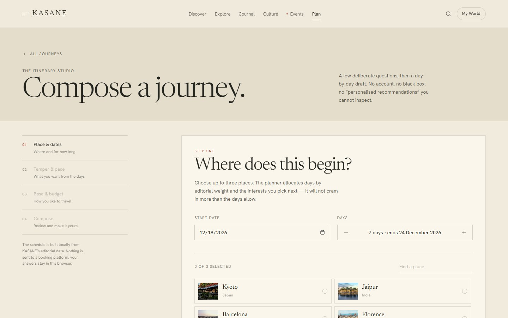

# KASANE

An independent editorial atlas of twenty-four places, their cultures, landscapes and the journeys between them. Read a destination in layers, save what stays with you, and compose a quieter trip from what you find. Everything runs in the browser, with no account, no tracking and no booking platform.

## Visuals

**Home — scroll journey into the atlas**

**The interactive atlas**

**Explore — map view**

**Field guide — Kyoto**

**Itinerary studio**

Photography and film are licensed from Unsplash and Pexels. Map data © OpenStreetMap contributors, rendered with OpenFreeMap.
